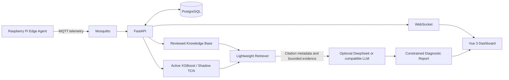
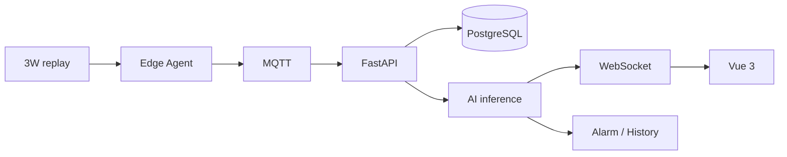
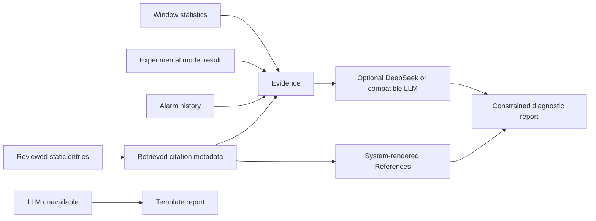

# 系统架构

## System Architecture

## Telemetry Data Flow

## Diagnosis Flow

知识检索目前只对 `docs/knowledge-base/manifest.json` 中的受审阅静态条目做关键词匹配；未实现文档上传、embedding、pgvector 或 FAISS 索引。条目的摘要参与检索和模板报告；外部 LLM 收到的是窗口统计、模型结果、报警摘要与引用元数据，不包含原始时序或知识文档全文。

LLM 分析文本由提示和 JSON 字段校验约束，仍需人工核验；References 和结构化 `citations` 由系统从检索集合生成。系统不提供现场控制执行能力。外部 API 不可用时保留模板报告，监控链路不受影响。

DeepSeek 成功返回与证据完整程度分别记录：报告 31 的 LLM 状态为 completed，但因为缺少同窗口离线 SHAP，证据状态仍为 degraded。当前实现参数和验收记录见 [DeepSeek 接入说明](deepseek-setup.md)。

离线 SHAP 生成链路现在保留非空井标识，并从样例首个连续 180 行回放窗口重新计算贡献，首末时间跨度为 179 秒。解释用窗口不按事件标签重置；原有带标签训练窗口逻辑不变。API 仍严格匹配模型版本、特征模式、井 ID 和首末时间。2026-10-18 重建的本地制品只覆盖四个首窗，后续窗口仍可降级；此次未更新生产环境，也不追溯修改历史报告。

## 知识库治理

`docs/knowledge-base/manifest.json` 是受控诊断的唯一检索知识来源。每个 `excerpt` 是经过人工审阅的检索分段，不是原文镜像；分段保留 source title、source/version、source identifier 及可得的 page/section。清理文档不改变 manifest 内容或路径，架构文档也保持原路径，便于历史报告引用。

- 仅收录公开、可访问且教学相关的资料，逐条记录 URL、版本、许可、标签和必要摘要。
- 不收录完整原始遥测、油井标识关联表、现场设定值、操作规程、MQTT/数据库配置、证书或凭据。
- 资料、摘要和标签经人工审阅与代码审查后才能部署；链接失效、许可不清或内容不可核验时撤下相应条目。

每次修改知识库，分别以 Normal、Severe Slugging、Flow Instability、Hydrate in Service Line 和未知/低置信度情形验证：前四类应获得语义相关、可打开且版本/许可齐全的来源；证据不足情形应拒答。核对 `[source-id]`、References 与结构化 `citations` 是否属于实际检索集合，人工检查事实性、覆盖率和响应耗时，不把引用扩展成现场控制建议。验证未通过时不发布新条目。

新增知识资料与报告中的人工建议均不改变系统的教学定位。当前实现的测试证据和未覆盖能力见 [评估与限制](evaluation-and-limitations.md)。
