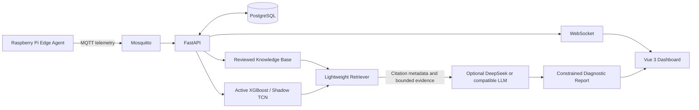
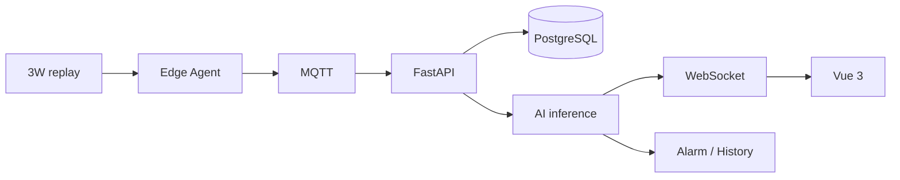
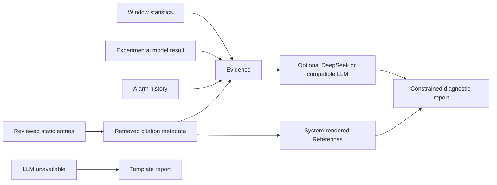

# 系统架构

## System Architecture

## Telemetry Data Flow

## Diagnosis Flow

知识检索目前只对 `docs/knowledge-base/manifest.json` 中的受审阅静态条目做关键词匹配；未实现文档上传、embedding、pgvector 或 FAISS 索引。条目的摘要参与检索和模板报告；外部 LLM 收到的是窗口统计、模型结果、报警摘要与引用元数据，不包含原始时序或知识文档全文。

LLM 分析文本由提示和 JSON 字段校验约束，仍需人工核验；References 和结构化 `citations` 由系统从检索集合生成。系统不提供现场控制执行能力。外部 API 不可用时保留模板报告，监控链路不受影响。

DeepSeek 成功返回与证据完整程度分别记录：报告 31 的 LLM 状态为 completed，但因为缺少同窗口离线 SHAP，证据状态仍为 degraded。当前实现参数和验收记录见 [DeepSeek 接入说明](deepseek-setup.md)。
